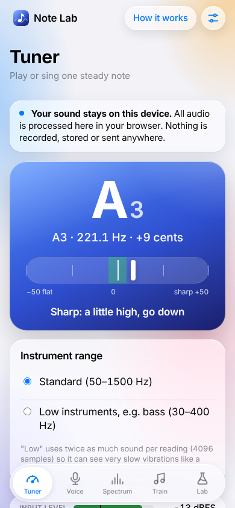
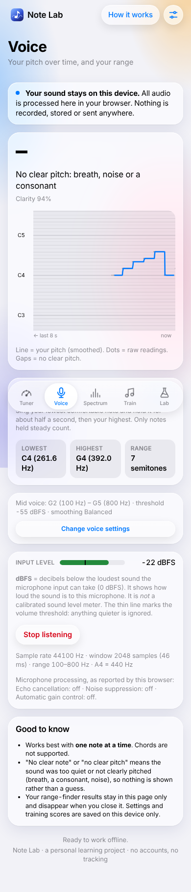
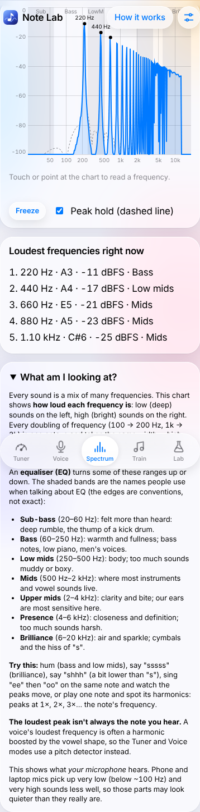
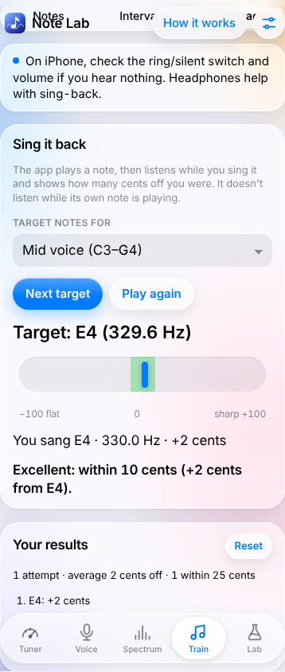
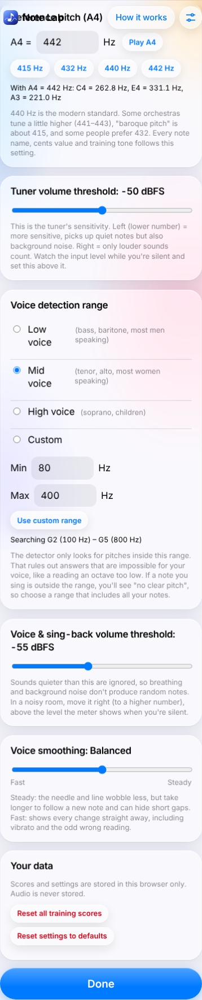

# Note Lab

A personal, non-commercial web app that listens **live** to your microphone and
shows which musical note is playing, its frequency and how many cents sharp or
flat it is, for example `A3 · 220.0 Hz · 0 cents`. It is meant for single notes
from instruments and the human voice. It also has a live spectrum view (for
learning about EQ), ear training, and a beginner's guide. It works offline and
can be installed on an iPhone home screen.

**Privacy:** all audio processing happens on your device, in the browser.
Microphone audio is never recorded, stored, uploaded or sent anywhere. There is
no server, no account and no tracking. Only your settings and training scores
are saved, in your own browser.

> **Status:** all 6 phases are built and tested in desktop Chromium:
> pitch maths, tuner, voice mode, spectrum, ear training, and offline /
> settings / guide. **Not yet tested on a real iPhone, and not yet measured on
> real recordings.** See [Desktop vs iPhone](#desktop-vs-iphone) and
> [Measured accuracy](#measured-accuracy).

| Tuner | Voice mode | Spectrum |
|---|---|---|
|  |  |  |

| Ear training (sing-back) | Settings |
|---|---|
|  |  |

*Screenshots from the automated Chromium test, with generated test sounds as the "microphone".*

## Look

Note Lab uses the same **Liquid Glass** theme as the other web apps:
`css/glass.css` is copied unchanged from msfs-buddy's `src/shared/glass.css`
(originally from Light Scout), and only Note Lab's own pieces live in
`css/style.css`.

- **Frosted glass cards** float over a soft, slowly drifting coloured light.
  Buttons, the segmented control and the top-bar capsules are clearer glass
  that springs when pressed. The tuner's reading sits on a lit blue pane.
- **The four modes are in a floating glass tab bar** at the bottom (thumb
  reach on a phone). Settings and *How it works* are capsules in the top bar,
  and each page has a large title, like iOS apps.
- Apple's system colours and font (SF Pro on Apple devices). It follows
  **light or dark mode**, and honours **Reduce Transparency** (solid surfaces
  instead of glass) and **Reduce Motion** (no drift or spring).
- Inspired by Apple's current design language; the tab icons and app icon are
  this project's own drawings.

## Getting it running

- **On your computer:** `npm start`, then open <http://localhost:8000>.
  (Needs [Node.js](https://nodejs.org) 18+, nothing to install.)
- **Online, for your phone (GitHub Pages):** in the GitHub repo go to
  **Settings → Pages → Build and deployment → Deploy from a branch**, choose
  `main` and `/ (root)`, and save. After a minute the app is at
  `https://<your-user-name>.github.io/note-lab/`. It must be **https**, or the
  microphone won't work.
- **Install on iPhone:** open that address in **Safari**, tap **Share → Add to
  Home Screen**. It then opens full-screen like an app, and works offline after
  the first visit.

## How to use

1. Tap **Start listening**. Your browser asks for microphone permission.
2. Play or sing **one steady note**. You'll see:
   - the note name and octave (big),
   - `note · frequency · cents` (one decimal place for Hz),
   - a needle: left is flat (too low), middle is in tune, right is sharp (too high).
     It turns green within ±5 cents. That band is a beginner-friendly display
     choice, not a measured accuracy.
   - the **input level in dBFS**. 0 dBFS is the loudest sound the input can
     take, so normal sounds read below 0, e.g. −30 dBFS. This is **not** a
     calibrated sound level meter (dB SPL).
3. If the sound is too quiet or isn't clearly pitched, the app shows
   **No clear note** instead of guessing.
4. For a bass or other very low instrument, choose **Instrument range → Low**.

### Voice mode

Tap the **Voice** tab (before or after starting). You'll see:

- **The current pitch**, e.g. `G2 · 98.0 Hz · −3 cents`, or **No clear pitch**
  with the reason: *too quiet* (below the volume threshold) or *breath, noise
  or a consonant* (loud enough, but not clearly pitched).
- **Clarity**: the detector's confidence that the sound is pitched (0–100%).
- **A scrolling pitch graph** of the last 8 seconds. It has a horizontal line
  for every note and labels for the Cs (or every natural note when there's
  room). The line is the smoothed pitch. Faint dots are raw readings, so you
  can see what the smoothing removes.
- **Range finder**: sing your lowest comfortable note and hold it for about
  half a second, then your highest. It records the lowest and highest notes
  you held steady and the range between them, e.g. "1 octave + 7 semitones".
  Results stay in the page only and are cleared when you close it.
- **Voice settings** (summary line, plus a button to open them on the
  Settings page): detection range (Low / Mid / High / Custom), volume
  threshold, and smoothing (Fast ↔ Steady). All are explained below.

### Spectrum

Tap the **Spectrum** tab to see **how loud each frequency is** in any sound,
not just notes. It's useful for learning about EQ.

- Low frequencies on the left, high on the right (20 Hz – 20 kHz). Each
  octave takes the same width. Height is the level in dBFS.
- Shaded **EQ bands** (Sub-bass, Bass, Low mids, Mids, Upper mids, Presence,
  Brilliance), with a plain explanation of each under the chart.
- **Loudest frequencies right now**: up to 5 peaks, each with its frequency,
  nearest note name (for musical pitches), level and band.
- **Touch or point** at the chart to read the frequency, band and level there.
- **Peak hold** (dashed line) shows recent loud moments, falling 20 dB per
  second. **Freeze** pauses the chart so you can study it.

### Ear training (Train tab)

Notes and intervals don't need the microphone. They only play sounds.

- **Notes, guess the note:** the app plays a note and you tap its name.
  By default it plays **C4 first as a reference**, because most people can't
  name notes without one (perfect pitch is rare). With a reference you learn to
  judge the distance. Choose the C major scale (white keys), all 12 notes, or
  two octaves. After answering, tap any note button to hear it and compare.
  Accuracy is tracked **per note**.
- **Intervals, name the gap:** the app plays two notes and you name the
  interval (minor 2nd … octave). Tick which intervals to practise (it starts
  with a gentle set: major 2nd, major 3rd, perfect 4th, perfect 5th, octave),
  and choose upwards, downwards or together. Each answer shows a well-known
  song as a memory aid. Accuracy is tracked **per interval**.
- **Sing-back:** the app plays a target note in your voice range, then
  listens while you sing it, showing live how many cents off you are. Once
  you've held a steady note for ~0.7 s it gives a result, e.g.
  `Good: 18 cents flat (too low)`. If you sing the right note in another
  octave, it says so and scores it ignoring the octave. It keeps your average
  and recent results.

Scores are saved on the device; reset them on the Settings page.

### Settings and the "How it works" page

**Settings** (the sliders button, top right) holds everything adjustable,
saved on the device:
- **Reference pitch (A4)**, 400–480 Hz: quick choices 415 / 432 / 440 / 442,
  a preview of what that does to other notes, and *Play A4*. Every note name,
  cents value and training tone follows it.
- **Sensitivity:** volume thresholds for the tuner and for voice/sing-back.
- **Voice range** and **smoothing**.
- **Reset** training scores or settings.

**How it works** (link at the top) is a plain-language guide: frequency, pitch,
notes, octaves, cents, the formula with a worked example, harmonics, YIN, dBFS,
limits and privacy. It also works offline.

## Acoustics Lab

The **Lab** tab has tools that teach the physics of sound. Each tool says
what is **Measured** (by the microphone) and what is **Calculated** (from a
model), and each has a *What am I looking at?* explanation and a *Formula*
card: the formula, every symbol with its unit, a worked example and where the
formula comes from. The maths lives in `js/acoustics.js`, tested in
`tests/acoustics.test.js` with worked examples you can check by hand.

**Microphone levels are relative.** Phone and laptop microphones aren't
calibrated, so every dB value is **dBFS** (relative to the input's maximum),
never a true sound pressure level.

**Microphone processing.** The app asks the browser to turn off echo
cancellation, noise suppression and automatic gain control. While listening,
the bottom card shows what the browser **reports** it did
(`MediaStreamTrack.getSettings()`):

| Browser | Echo cancellation | Noise suppression | Auto gain | How we know |
|---|---|---|---|---|
| Desktop Chromium (fake mic in the automated test) | off | off | off | `tools/browser-test.js` |
| iPhone Safari | *not yet checked* | | | Read the line under "Stop listening" and report back |

A browser's report can't see processing done by the phone's hardware or
operating system, so treat "off" as "the browser says it isn't adding any".

### 1. Waveform (oscilloscope)

Shows the microphone signal against time. **Time zoom** goes from 2 to 200 ms
across the screen, and **height zoom** from ×1 to ×20 (it magnifies the
picture, not the sound). **Steady display** starts each picture at a rising
zero crossing (oscilloscope "triggering"), so repeating waves stand still.
**Freeze** pauses it. When there's a clear pitch, one period **T** is marked
and **f = 1/T** is shown.

- *Formula:* f = 1/T (definition of frequency). Example: T = 2.2727 ms → f ≈ 440 Hz.
- *Measured:* the wave, peak and RMS level (dBFS, relative), and the period
  (via the YIN detector).
- *How to test:* `npm test` (zero-crossing and period maths). Then Lab →
  Waveform → Start microphone and whistle a steady note: the shape should
  stand still and T should match the note (440 Hz ↔ 2.27 ms). The automated
  browser test plays a 440 Hz tone and checks it reads `T = 2.273 ms → 440.0 Hz`.
- *Assumptions and limits:* the height is a fraction of full scale, not
  pressure in pascals. The display uses ~0.34 s of sound (16384 samples) and
  shows the newest part. The trigger needs a wave that dips below −1% of full
  scale, so very quiet sounds free-run (they don't stand still). The period
  marker only appears when the pitch detector finds a clear pitch. The
  microphone and the phone's own filters can change the wave's shape (for
  example, they cut very low frequencies), so the shape is "as the mic sees
  it", not the exact air pressure.

### 2. Harmonics viewer

Finds the fundamental f₀ (YIN) and measures harmonics 1–10 in the spectrum.
Bars show dB **relative to the loudest harmonic**; the table shows where each
harmonic was found and how many cents it is from exactly n × f₀. **Compare:**
capture sound A and sound B (each with a label), or make B a **calculated**
tone (sine, square, sawtooth, or Note Lab's training tone) from its Fourier
series. *Play it* plays that tone, so you can also capture it through your
speaker and mic and see how they change a "perfect" tone.

- *Formulas:* f_n = n × f₀ (Fourier's theorem; harmonic series), and
  L = 20 × log10(a / a_ref) dB. Square wave: odd harmonics at 1/n; sawtooth:
  all harmonics at 1/n (standard Fourier series).
  Example: f₀ = 220 Hz → 440, 660, 880 Hz; half amplitude = −6.02 dB.
- *Measured:* f₀, each harmonic's frequency, cents offset and relative level.
  *Calculated:* the reference tones' bars.
- *How to test:* `npm test` checks a synthetic 1/n tone: harmonic n comes out at
  20·log10(1/n) dB within 0.4 dB and at n × 220 Hz within 0.5 Hz. A sine has
  only harmonic 1, and the square-wave reference has 3rd at −9.54 dB and 5th at
  −13.98 dB. In the browser test, the `bright-A3` file (220 Hz, 1/n) measured
  2nd −5.9 dB and 3rd −9.4 dB, and A (measured) vs B (calculated sawtooth)
  differed by 0.0–0.3 dB for n = 1–5. To try it yourself: sing "ee" and capture
  it as A, then sing "oo" on the same note and capture it as B.
- *Assumptions and limits:* the sound must have a clear pitch (one note).
  Harmonics are searched within ±3% of n × f₀ (at least ±3 bins, at most ±40% of
  f₀), so strongly inharmonic sounds (bells, drums) won't fit this model. Bins
  are ~5.9 Hz wide (8192 samples), so for low notes the higher harmonics are
  found precisely, but a harmonic below the noise (−90 dBFS) shows as "not
  found". Readings are briefly off when a note starts, stops or changes (the
  0.17 s window then holds two different sounds). Mic and speaker frequency
  response colour the bars, especially below ~100 Hz and above ~10 kHz.

### 3. Beats demo

Plays two pure tones: f₁ (110–880 Hz) and f₂ = f₁ + Δ (Δ from −20 to +20 Hz).
It shows the **beat frequency** |f₁ − f₂|, the beat period, the heard pitch, and
a **calculated** graph of the two tones added together with their envelope; a
line sweeps through it in real time while playing. Optional: **one tone per
ear** (headphones), so the tones never add up in the air. Any pulsing you
then hear comes from the brain ("binaural beats").

- *Formulas:* sin(2πf₁t) + sin(2πf₂t) = 2·cos(π(f₁−f₂)t)·sin(π(f₁+f₂)t)
  (sum-to-product identity) → f_beat = |f₁ − f₂|, T_beat = 1/f_beat, heard
  pitch ≈ (f₁+f₂)/2. Example: 440 and 443 Hz → 3 Hz, one beat every 0.333 s,
  heard at 441.5 Hz.
- *Calculated:* everything shown. The sound is generated, not measured.
- *How to test:* `npm test` checks the identity at many times, and that the
  envelope is 2 every beat period and 0 halfway between. In the browser test,
  Δ = +3 shows `f_beat = 3.0 Hz`, the page really starts oscillators at 440 and
  443 Hz, and leaving the Lab tab stops both. To try it yourself: play it and
  slide Δ slowly to 0; the beats should slow down and stop. Count the pulses
  for 10 s at Δ = 1 Hz: you should count about 10.
- *Assumptions and limits:* pure sine tones of equal loudness (unequal
  loudness gives shallower beats). The "roughness above roughly 15–20 Hz" note
  describes hearing research (Plomp & Levelt, 1965) and varies between people
  and frequencies; it's guidance, not a formula. Phone speakers play low
  frequencies poorly, so use f₁ above ~200 Hz on a phone, or headphones. One
  tone per ear needs headphones and a browser that supports stereo panning.

### 4. Spectrogram

Frequency (up) against time (across), with loudness as colour (dark = quiet,
bright = loud; −100 to −10 dBFS, relative). **Window size** goes from 512 to
8192 samples; the page shows the resulting Δt and Δf live. There's a **log or
linear** axis, a choice of top frequency (2–20 kHz), and **Freeze**. The colour
scale is an "inferno"-style map whose brightness always rises with level.

- *Formulas:* Δt = N/fs, Δf = fs/N, so Δt × Δf = 1 (DFT bin spacing; the
  short-time Fourier transform's time–frequency trade-off, Gabor 1946).
  Example: N = 2048, fs = 48 kHz → Δt = 42.7 ms, Δf = 23.4 Hz.
- *Measured:* the picture (dBFS, relative). *Calculated:* Δt and Δf.
- *How to test:* `npm test` checks the worked example, the 4× trade-off, and
  that the colour map always gets brighter. The browser test plays a 440 Hz tone
  and checks that the brightest pixel row in the newest column is at 440 Hz on
  the log axis (within half a bin), and that changing the window to 8192
  changes Δt and Δf and the microphone's window. To try it yourself: sing a
  slow scale (a staircase with harmonics above it), say "sss" (a high smear, no
  lines), or clap (a thin vertical stripe). Move the window slider while
  singing: long windows give thin lines but smeared timing; short windows give
  sharp timing but thick, blurry lines.
- *Assumptions and limits:* a new column arrives about every 17 ms whatever
  the window size, so long windows overlap heavily (smearing sideways). With
  a Hann window, two tones need about 2·Δf to show as separate lines. Where a
  pixel row is narrower than a bin, the colour is read between bins; where
  several bins share a row (high frequencies, log axis), the loudest is shown.
  Peaks are placed to within about half a bin. Levels above −10 dBFS all show
  the brightest colour. The time label is estimated from the measured column
  rate. Mic frequency response darkens very low and very high regions.

### 5. Pipe and string calculator

Choose **open pipe**, **closed pipe** or **string**. For pipes, enter the length
(m) and air temperature (°C), and optionally the inner diameter for an end
correction. For strings, enter the length (m), tension (N) and mass per length
μ (kg/m), or work out μ from the diameter and **a density you provide**. It
shows the speed of sound with the working, the first 6 resonances with
harmonic number and **nearest note** (Note Lab's pitch code, at your A4
setting), *Play* buttons (pure tones), *Play all*, and a drawing of the
selected mode's standing wave.

- *Formulas:* c = 331.3·√(1 + T/273.15) m/s (ideal gas, c = √(γRT/M), dry air);
  open pipe f_n = n·c/2L; closed pipe f_n = (2n−1)·c/4L; end correction
  ΔL ≈ 0.6133·r per open end (unflanged; Levine & Schwinger, 1948); string
  v = √(T/μ), f_n = n·v/2L (Mersenne's laws); μ = ρ·π·(d/2)².
  Examples: 20 °C → 343.2 m/s; open 0.5 m → 343.2 Hz (F4 −30 cents);
  closed 0.5 m → 171.6, 514.8 Hz; string 0.65 m / 70 N / 0.0012 kg/m → 185.8 Hz.
- *Calculated:* everything on this page.
- *How to test:* `npm test` runs each worked example above, plus the
  end-correction example (r = 10 mm → 6.13 mm; 0.5 m open pipe → 335.0 Hz) and
  checks the mode shapes (open ends = antinodes, closed end and string ends =
  nodes). The browser test checks the same numbers on the page, the note names,
  30 °C → 349.0 Hz, that *Play* really plays 343.2 Hz, the μ calculation, and
  that a zero length shows a message. To try it yourself: measure a tube (e.g.
  a kitchen-roll tube), enter its length, blow across one end or tap it, and
  compare with the predicted f₁ (and record it on the compare page).
- *Assumptions and limits:* ideal cylinders with perfectly open or closed
  ends; dry air (humidity raises c by well under 1%); the end correction is
  approximate and ignores its slight change with frequency; real instruments
  (tone holes, cones, mouthpieces) differ, as do flanged ends (correction ≈
  0.82·r). Strings are assumed perfectly flexible: real stiff strings (piano,
  thick guitar strings) have higher modes slightly sharp, and wound strings
  weigh more than μ = ρ·π·(d/2)² suggests. Phone speakers can't play low modes
  well (below ~100–200 Hz).

### 6. Room modes calculator

Enter the room's length, width and height (m) and the air temperature;
optionally an RT60 (s) to see the Schroeder frequency. It lists the **axial
modes** up to 150/300/500 Hz with nearest note, where each one is **silent**
(its pressure nulls, in metres from a wall), *Play* (a pure tone, 3 s) and
*Compare*. It marks them on a frequency chart (coloured by dimension), flags
**close pairs** from different dimensions, and can also count and show the
tangential and oblique modes. The page explains what modes mean for mixing
and EQ.

- *Model assumptions (stated on the page):* a rectangular room with perfectly
  rigid, fully reflecting walls, empty, at a uniform temperature.
- *Formulas:* Rayleigh, f = (c/2)·√((n_x/L)² + (n_y/W)² + (n_z/H)²); axial
  f = n·c/2L; nulls at x = (2k−1)·L/(2n); Schroeder f_S ≈ 2000·√(T60/V)
  (Schroeder 1962; Kuttruff, *Room Acoustics*). c from temperature as in tool 5.
  Example: 5 × 4 × 2.5 m at 20 °C → length 34.3, 68.6, 103.0 Hz; width
  42.9 Hz; height 68.6 Hz (a close pair with length 2); tangential (1,1,0)
  54.9 Hz; 1st length mode silent at 2.5 m; T60 0.5 s, V 50 m³ → f_S 200 Hz.
- *Calculated:* everything on this page.
- *How to test:* `npm test` runs all the numbers in the example. The browser
  test checks them on the page, that *Play* produces 34.32 Hz, and that a
  negative height shows a message. To try it yourself: enter your room, play the
  lowest few modes through **proper speakers** (not a phone), walk around and
  listen for loud and quiet spots, then note what you hear on the compare page.
- *Assumptions and limits:* real walls flex and absorb bass (especially
  plasterboard), doors and windows leak, furniture scatters sound, and
  non-rectangular rooms have different modes. Real modes are therefore
  shifted and broader, and only the strongest few are clearly audible. The
  "close pair" 3% threshold is this app's own simple rule of thumb, not a
  standard. Schroeder's formula is an estimate of where modes stop
  standing out, not a sharp boundary. The mixing and EQ advice is general
  studio-acoustics guidance.

## How the detection works

### From frequency to note (`js/pitch-math.js`)

Standard equal-temperament formulas, with A4 = 440 Hz by default:

```
note number  n = 69 + 12 × log2(f / 440)      (A4 = 69, middle C = C4 = 60)
nearest note m = round(n)
cents          = 100 × (n − m)                 (−50 … +50)
name           = C C# D D# E F F# G G# A A# B  [m mod 12]
octave         = floor(m / 12) − 1
back again:  f = 440 × 2^((m − 69) / 12)
```

**Worked example, 330 Hz:** 330/440 = 0.75 → log2(0.75) = −0.41504 → × 12 =
−4.98045 → n = 64.01955 → m = 64 → cents = +1.96 → 64 mod 12 = 4 = **E**,
octave = floor(64/12) − 1 = **4** → `E4 · 330.0 Hz · +2 cents`.
(Perfect E4 = 440 × 2^(−5/12) = 329.628 Hz.)

Run `npm run table` to print every note's frequency and check it with a calculator.

### Finding the frequency: YIN (`js/yin.js`)

A pitched sound repeats itself. YIN shifts the sound against a copy of itself
and measures how *different* the two are at each shift. The **first** shift
where they're almost identical is one period, and frequency = sample rate ÷
period. Normalising the score and taking the first good dip, rather than the
deepest, avoids most octave mistakes. A small curve fit between samples gives
sub-cent precision on clean tones. The depth of the dip is a confidence score.
If no dip is deep enough, the answer is "no clear pitch".

Each reading uses the latest **2048 samples** (about 43–46 ms), about 60 times
a second.

### Volume gate and smoothing

- **Volume gate:** readings quieter than **−60 dBFS** aren't analysed at all,
  so background hiss doesn't produce random notes. The gate is the thin line
  on the level meter.
- **Smoothing (`js/smoothing.js`):** the display shows the **median** of the
  last 7 readings (about 0.12 s), and only when at least 4 of them found a
  pitch. A median ignores a few odd readings, such as a one-off octave jump.
  The cost is a short delay when you change note.

### Voice detection range: how it reduces octave errors

YIN looks for a repeat of the sound by trying every possible length of one
vibration. The range tells it which lengths to try. A low pitch has a long
vibration, a high pitch a short one:

```
shortest vibration tried = sample rate ÷ max Hz      longest = sample rate ÷ min Hz
e.g. Mid voice at 48 kHz:   48000 ÷ 800 = 60 samples      48000 ÷ 100 = 480 samples
```

Anything outside that window **can't be chosen**. The most common octave
mistake on low voices is reading **one octave too low**. It happens when the
sound repeats exactly every *two* vibrations, e.g. a rough or creaky voice
where every other vocal pulse is a little different. If the range starts above
that too-low pitch, the mistake becomes impossible.

| Preset | Range | Intended for |
|---|---|---|
| Low | 65–500 Hz (C2–B4) | bass, baritone, most men speaking |
| Mid | 100–800 Hz (G2–G5) | tenor, alto, most women speaking |
| High | 150–1200 Hz (D3–D6) | soprano, children |
| Custom | 40–2000 Hz, max ≥ 1.5 × min | anything else |

**Measured on the generated files** (raw readings):

| Rough low voice (G2 with a sub-harmonic) | Found | Wrong note |
|---|---|---|
| Range 35–1500 Hz | 99% | **100%, all read as G1 (octave low)** |
| Low preset (65–500 Hz) | 0%: "no clear pitch" | 0% |

| All voice-like files | Found | Median error |
|---|---|---|
| Range 35–1500 Hz | 100% | 2.5 cents |
| Low preset | 100% | 1.3 cents |
| Mid preset | 86% (the low G2 voice is below it) | 1.2 cents |
| High preset | 67% (low voices and speech are below it) | 1.1 cents |

What this shows:

- The right range **removed the octave error**. It didn't produce the right
  note, though. The app says "no clear pitch" because, inside the range, the
  sound wasn't clearly periodic enough to pass YIN's strict test. I chose not
  to loosen that test: it would mean guessing, based on artificial files.
- A narrower range is also **more precise** (2.5 → ~1.2 cents), because each
  window has more samples left to compare.
- A range that **doesn't include your voice** mostly gives "no clear pitch",
  not wrong notes. In one case (G2 with the Mid preset), 9% of readings were
  wrong. **Pick a range that covers all your notes.**

### Volume threshold and "no clear pitch"

Two separate checks stop random numbers:

1. **Volume threshold** (voice default −55 dBFS, slider −80 to −20). Anything
   quieter isn't analysed at all. Use it against background noise: watch the
   level meter while you're silent and set the threshold above that level.
2. **Clarity check** (inside YIN). Loud sounds that don't repeat regularly,
   like breath, whispers, "s"/"sh"/"f" consonants and hiss, fail it.

On the generated files: whisper, room noise and near-silence showed a note
**0%** of the time. The hissy consonants in the speech-like file showed a
note 0% of the time.

### Smoothness vs responsiveness

The smoothing keeps the last few readings and shows their median. More
readings means a steadier display, but a slower one. Measured with
`npm run tradeoff` ([results](docs/evaluation/smoothing-tradeoff.md)):

| Smoothing | Readings kept | New note appears after | Short gaps (0.1 s) visible | Needle wobble on vibrato (true ≈ 21 cents) |
|---|---|---|---|---|
| Fastest | 1 (~17 ms) | 19 ms | 5 of 5 | 20.1 cents |
| Fast | 3 (~50 ms) | 36 ms | 5 of 5 | 19.5 cents |
| **Balanced** (default) | 7 (~117 ms) | 69 ms | 5 of 5 | 13.6 cents |
| Steady | 15 (~250 ms) | 106 ms | 0 of 5 | 8.9 cents |
| Steadiest | 25 (~417 ms) | 189 ms | 0 of 5 | 5.8 cents |

**In plain words:** *Fast* shows your vibrato and every change (good for
watching technique). *Steady* hides vibrato and shows the average pitch (good
for "am I on the note?"), but notes take up to ~0.2 s to appear and short
breaks disappear. These times don't include the ~43 ms of sound each reading
needs, or any delay in your device's audio system.

### Range finder: what counts as "stable"

A note counts when the smoothed pitch stays within **70 cents** of one note
for **0.3 s**. The 70-cent allowance is so vibrato doesn't break it. Slides
and one-off readings don't count. Tested: the generated C4–G4 scale gives
exactly C4 → G4. A slide from C3 to C4 counts only the two held ends, not the
notes slid through.

### How the spectrum works (`js/fft.js`, `js/spectrum.js`)

1. Take the latest **8192 samples** (~170 ms at 48 kHz).
2. Fade the ends in and out (a *Hann window*). Without this, the sudden start
   and end of the piece of sound would smear energy across all frequencies.
3. Run an **FFT** (Fast Fourier Transform). It measures how much of each of
   4096 evenly spaced frequencies ("bins") is present. Bin width = sample rate
   ÷ 8192 ≈ **5.9 Hz** at 48 kHz.
4. Scale so a sine wave of amplitude A reads **20 × log10(A) dBFS**: a
   full-scale sine reads 0, half of that reads −6.
5. For display, smooth over time (60% previous + 40% new) so the line doesn't
   jitter, and find peaks. A parabola fitted through the top bins gives a more
   exact peak frequency.

The FFT is my own short implementation, not the browser's built-in analyser.
That way the maths is in a file you can read and test. It's checked in the
tests against a slow, direct calculation, and each reading takes ~0.7 ms on a
desktop computer. **The trade-off:** a bigger window separates low notes
better (finer bins), but reacts more slowly and blurs quick changes. 8192 is a
compromise.

**Two different "dB" numbers:** the level meter shows the **RMS level of the
whole sound**. The spectrum shows the **amplitude at each frequency**. A pure
sine peaking at −6 dBFS in the spectrum shows about −9 dBFS on the meter (RMS
is 3 dB lower for a sine). Both are correct; they measure different things.

**Measured on generated files** (`npm run spectrum-check`,
[full results](docs/evaluation/spectrum-check.md)):

| File | Contains | Loudest frequency found | Level |
|---|---|---|---|
| sine-A4 | A4, 440 Hz | 440.0 Hz | −5.99 dBFS (true −6.02) |
| sine-C4 | C4, 261.63 Hz | 261.5 Hz | −5.83 dBFS (true −6.02) |
| sine-E4-330Hz | 330 Hz | 330.1 Hz | −5.86 dBFS (true −6.02) |
| weak-fundamental-A2 | A2, 110 Hz | **220 Hz (A3)** | −11.3 dBFS |
| voice-low-G2-vibrato | G2, ≈98 Hz | **679 Hz**: the "ah" vowel's resonance | −19.7 dBFS |

On pure tones the spectrum is within **0.13 Hz and 0.2 dB**. The last two
rows are the EQ lesson: **the loudest frequency is often not the note you
hear.** It can be a harmonic or a resonance of the vowel. That's why the Tuner
and Voice modes use YIN and don't just pick the biggest peak.

### How ear training plays and judges notes (`js/tone-player.js`, `js/ear-training.js`)

- **Tones** are generated in the browser (Web Audio oscillators), not
  recordings: a fundamental plus a few quieter harmonics, for a soft organ-like
  sound, with a 15 ms fade-in and a 150 ms fade-out so they don't click.
  **Checked:** rendered offline in Chromium and measured with the app's own YIN
  detector, C3, A3, C4, A4 and C5 all play at **0 cents**.
- **Sing-back never listens to its own note.** The microphone input is ignored
  until 0.25 s after the target has faded. Otherwise it would score the
  speaker instead of you.
- **"Steady"** means the readings stayed within 60 cents of each other for
  0.7 s (that allows gentle vibrato). The result is their median. After 8 s
  without a steady note it says so, instead of guessing.
- **The labels** *Excellent / Good / Close* mean within 10 / 25 / 50 cents.
  They're friendly display choices, not a standard.
- **Checked end to end** in Chromium with a fake microphone: target C4 with
  a C4 tone "sung" back → `0 cents`; target E4 with the 330 Hz test tone →
  `+2 cents`, matching the worked example.

### Offline use and installing (`sw.js`, `manifest.json`)

- A **service worker** (`sw.js`) is a small script the browser keeps. On the
  first visit it saves the app's own files. After that, it tries the network
  first, so you always get the latest version when online, and falls back to
  the saved copy when you're offline. Nothing else is stored: no audio, no data
  about you. (The test WAVs aren't cached; the app never uses them.)
- **`manifest.json`** and the **icons** (`icons/`, made by `tools/make-icons.js`
  from one SVG) let browsers install the app. iPhone uses
  `apple-touch-icon.png` and the `apple-mobile-web-app-*` tags in `index.html`.
- A unit test checks that every app file is in the offline list. A browser
  test loads the app, switches the network off, reloads, and checks that the
  app and the guide page still work.

### Why YIN and not autocorrelation? (measured)

Both were run on the same test files (`npm run evaluate`). Columns: **Found** =
share of pitched moments where a pitch was reported. **Median** = typical error
in cents. **>50c** = share of reported pitches that were the wrong note.

| Test group | YIN: Found | YIN: Median | YIN: >50c | Autocorrelation: >50c |
|---|---|---|---|---|
| Clean tones | 100% | 0.1 | 0% | 50%: C4 and E4 sine waves read an octave low |
| Weak fundamental (A2) | 100% | 0.0 | 0% | 99%: read as A3 |
| Voice-like (vibrato, glide, scale, speech) | 100% | 2.5 | 0% | 24% |

The simple autocorrelation (`js/autocorrelation.js`, kept only for this
comparison) often locks onto 2 periods instead of 1. Better autocorrelation
variants exist (e.g. McLeod's MPM). YIN does well here and is well documented,
so the app uses YIN.

## Measured accuracy

> ⚠️ **These numbers come from computer-generated test signals**
> (`test-audio/generated/`, made by `npm run make-signals`). They are cleaner
> than real voices and instruments, so **real-world accuracy will be lower**.
> Measurements on real recordings will be added separately.

YIN with a 2048-sample window and a −60 dBFS gate, before smoothing. It
searches 35–1500 Hz, a little wider than the tuner's 50–1500 Hz, so the
very-low and octave-trap cases show up. Full tables, including each voice
preset and the 4096-sample window: [`docs/evaluation/`](docs/evaluation/).

| Test group | Found | Median error | Wrong note (>50c) | Octave errors | False notes in no-pitch sounds |
|---|---|---|---|---|---|
| Clean tones (sine, bright) | 100% | 0.1 cents | 0% | 0% | – |
| Weak fundamental | 100% | 0.0 cents | 0% | 0% | – |
| Rough low voice with sub-harmonic | 99% | 1200 cents | **100%** | **100%** (read an octave low) | – |
| … same, with any range starting ≥ 50 Hz | 0%: "no clear pitch" | – | 0% | 0% | – |
| Voice-like | 100% | 2.5 cents | 0% | 0% | 0% |
| Room noise, SNR 20 dB / 10 dB | 100% / 98% | 0.2 / 0.5 cents | 0% | 0% | – |
| Room noise, SNR 0 dB | 0%: "no clear note" | – | – | – | – |
| Breathy voice (breath as loud as voice) | 0%: "no clear note" | – | – | – | – |
| Quiet tone (−50 dBFS peak) | 100% | 0.1 cents | 0% | 0% | – |
| Guitar low E2 (82 Hz) | 100% | 0.0 cents | 0% | 0% | – |
| Bass low E1 (41 Hz), standard window | 2% (out of range) | – | – | – | – |
| Bass low E1, tuner "Low" range (4096 window) | 100% | 0.0 cents | 0% | 0% | – |
| Whisper, room noise, near-silence | – | – | – | – | **0%** |

**What the smoothing does to these numbers:** the smoothed display holds each
note a little longer (about 0.1 s) and evens out vibrato. Measured against the
moment-by-moment true pitch, smoothed voice readings are off by a median of
**23 cents**, versus 2.5 raw. That's mostly the display trailing behind vibrato
and slides, not wrong notes: the wrong-note rate stays at 1%. The hold also
means a note stays on screen for a moment after you stop. In the short
(0.1 s) gaps of the scale and speech tests, 34% of gap moments still showed
the previous note. Voice mode lets you choose between steadier and faster
(see *Smoothness vs responsiveness* above).

**A tuning decision made from these tests:** YIN's threshold started at 0.15.
That read a vowel-like E4, whose 2nd harmonic was ~6× louder than its
fundamental, as **E5**. Lowering it to 0.10 (the value in the YIN paper) fixed
that and changed nothing else on these files. Because the choice was made on
generated signals, it still needs checking on real recordings.

## Limitations

- **One note at a time.** Chords and several notes at once are not supported.
  The app will show one of the notes, or "no clear note", and shouldn't be trusted.
- **Octave errors** are reduced, not eliminated. A sound whose 2nd harmonic is
  much louder than the fundamental can still be read an octave high. A rough
  or creaky voice can be read an octave **low** if the range reaches that low.
  With a suitable range it shows "no clear pitch" instead, so very rough or
  creaky singing may not register.
- **The range must cover your voice.** Notes outside the selected range show
  "no clear pitch", or occasionally a wrong note (9% of readings in one test).
- **Range finder** counts a note only after 0.3 s within 70 cents. Very short
  notes don't count, and a note sung about halfway between two notes may not
  settle on either.
- **Breathy or whispered sound** has little or no pitch. At equal breath and
  voice level the app says "no clear note". That's intended, but it means very
  breathy singing may not register.
- **Very low notes:** with the standard 2048-sample window the lowest
  detectable pitch is about 47 Hz at 48 kHz. For a bass's low E (41 Hz), use
  the tuner's **Low** range (4096 samples, 100% on the test file). It reacts
  more slowly (~85–93 ms of sound per reading). In tests it also handled vocal
  vibrato worse (90% found vs 100%), so voice mode keeps the 2048 window.
- **Noisy rooms:** fine at 10–20 dB SNR on the test files, nothing at 0 dB.
- **The dB meter** is relative to this microphone (dBFS), not a calibrated
  sound level. iPhones may also adjust the mic level automatically.
- **The spectrum shows what the microphone hears.** Phone and laptop mics
  pick up very low (below ~100 Hz) and very high frequencies less well. iPhone
  audio processing may also change the balance, so don't treat the chart as
  a lab measurement of the room.
- **Spectrum resolution:** bins are ~6 Hz wide, so two frequencies closer than
  about 12 Hz (e.g. two low notes a semitone apart below ~200 Hz) can merge
  into one peak. The 170 ms window also blurs very fast changes like drum hits.
- **Spectrum peaks are not a chord detector.** You'll see peaks for every
  note's harmonics, which overlap. Naming the notes of a chord from them isn't
  supported.
- **Ear training sound on iPhone:** the ring/silent switch may mute the
  tones. The app asks Safari (16.4+) to play anyway, but that isn't tested on a
  real iPhone; the page shows a hint. While the microphone is on, iPhones may
  play sound more quietly or through the earpiece, so **headphones** help with
  sing-back.
- **Sing-back** needs you to hold a steady note for ~0.7 s. Very short or
  very wobbly notes time out with "No steady note heard".
- **Note guessing without the reference** is very hard for most people, and
  that's normal; it's why the reference is on by default.
- **Offline** works only after one online visit, and only in a browser that
  supports service workers (current Safari, Chrome, Firefox, Edge).
- **Accuracy numbers** are from generated signals only, so far.

## Desktop vs iPhone

| | Desktop Chromium | iPhone Safari |
|---|---|---|
| Tested by | Automated test (`tools/browser-test.js`) with test WAVs as a fake microphone | **Not tested yet.** Needs a real iPhone |
| Sample rate seen | 44 100 Hz (fake mic) | Usually 48 000 Hz (to be confirmed) |

Things to check on iPhone (please report back):

1. Open the page over **https** (GitHub Pages). The mic won't work on plain http.
2. Tap Start: you should see the permission prompt, then the tuner.
3. Tap "Don't Allow" once: you should get the "blocked" message with steps to fix it.
4. Hum a steady note: the note should be steady, and the level should move with your voice.
5. Voice tab: sing a slow scale. The graph should scroll smoothly (not stutter),
   and the range finder should fill in. Try each smoothing setting.
6. Spectrum tab: say "sssss" (the peak should be far right) and hum (left).
   Slide a finger across the chart; the page shouldn't scroll while you do.
7. Switch to another app and back: the tuner should continue, or tell you to tap Start.
8. Whether iOS respects "no echo cancellation / noise suppression / auto gain".
   If quiet sounds get louder by themselves, it doesn't.
9. Train tab → Notes: tap *Play a note* **with the silent switch on and off**.
   Do you hear it both times?
10. Sing-back with and without headphones: is the target note loud enough while
    the mic is on? Does the result look right?
11. **Add to Home Screen**, open it from the icon, then turn on Airplane Mode and
    open it again. Does it still load? Does it ask for the microphone every time?
12. Settings: change A4 to 442, close and reopen the app. Is it remembered?

## Running the tests

Needs [Node.js](https://nodejs.org) 18 or newer. There are no packages to install.

```sh
npm test               # unit tests: pitch maths, YIN, smoothing, dB level, ranges, FFT/spectrum, ear training, settings, offline file list,
                       # range finder (incl. full pipeline on generated files), WAV files
npm run table          # note/frequency table for checking by hand
npm run make-signals   # regenerate the test WAV files (identical every time)
npm run evaluate       # score the detectors on test-audio/generated
npm run evaluate -- --preset=low    # try other settings (also --window, --threshold, --gate, --min, --max, --smoothing)
npm run tradeoff                    # smoothness vs responsiveness for each smoothing level
npm run spectrum-check              # spectrum peaks and levels on generated files
node tools/browser-test.js          # optional; needs Playwright + Chromium installed
node tools/make-icons.js            # optional; re-render the icons (needs Playwright)
```

## Project layout

```
index.html, how-it-works.html   the app and the beginner's guide
manifest.json, sw.js, icons/     install + offline
css/glass.css                    shared Liquid Glass design (copied unchanged from msfs-buddy)
css/style.css                    Note Lab's own styles on top of it
js/pitch-math.js                 ★ frequency ↔ note maths (start here)
js/yin.js, js/smoothing.js, js/level.js, js/pitch-tracker.js   pitch detection pipeline
js/fft.js, js/spectrum.js        spectrum maths
js/voice-ranges.js, js/range-finder.js, js/ear-training.js, js/settings.js   other logic
js/*-view.js, js/app.js, …       page code (what you see and tap)
js/autocorrelation.js            only for the YIN comparison, not used by the app
tests/                           unit tests (npm test)
tools/                           test-signal generator, evaluators, local server, browser test
test-audio/generated/            generated test WAVs + truth files
docs/evaluation/, docs/screenshots/   measured results and screenshots
```

## Dependencies

None for the app. It uses only the browser's built-in Web Audio API. Tests use
Node's built-in test runner. The optional browser check uses Playwright, which
isn't part of the app and isn't installed by this project.

## How AI help was used

This project was built with Claude Code (an AI coding assistant), working
phase by phase at the owner's direction:

- The AI wrote the code, tests, test-signal generator and this README, and
  explained each step. The owner approves each phase before the next.
- The formulas are the standard equal-temperament relationships. YIN follows
  de Cheveigné & Kawahara (2002). Nothing was invented.
- The accuracy numbers come from running the code (`npm run evaluate`,
  `npm run tradeoff`) and weren't estimated. The AI also caught and fixed its
  own mistakes this way: a wrong truth label for the plucked note, a threshold
  that caused an octave error, a needle animation that pointed the wrong way
  during vibrato, a broken "release time" measurement, and spectrum labels
  that showed "1000 Hz" instead of "1.00 kHz" or were cut off.
- Where test results suggested loosening detection to get more notes (the
  rough-voice case), the AI kept the strict behaviour. "No clear pitch" is
  better than a guess tuned on artificial data. That choice is documented
  rather than hidden.
- Typical voice ranges in the presets come from general music and speech
  knowledge (e.g. men speaking ≈ 85–155 Hz). They're broad guides, not
  measurements of any particular person.
- In the ear-training and offline phases, tests caught a "+0 cents" display
  bug, an unhandled error when rendering tones offline, and a page missing
  from the offline list (caught by the new test before it was ever shipped).
  Reading the code before running it caught a start-up crash (code using a
  variable before it was created).
- When asked to carry out the last phases without stopping, the AI still
  tested and committed each step separately. Everything above about iPhone
  behaviour is a list of things to check, not something that was tested.
- The AI can't hear and has no iPhone, so iPhone behaviour and real-world
  accuracy have to be checked by a person.
